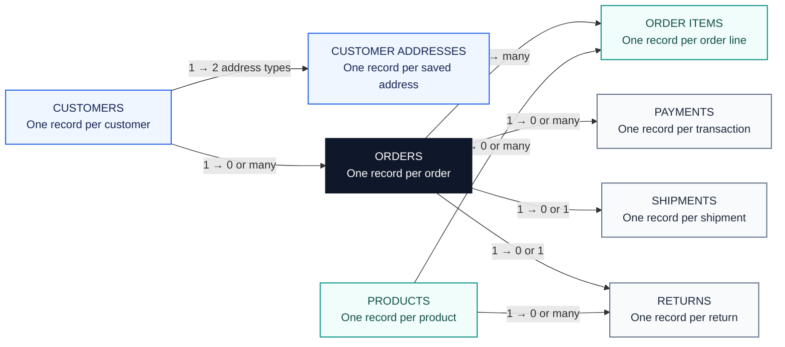

# RetailOps 360 — E-Commerce Operations & Revenue Analytics

**An e-commerce business analysis project covering customers, payments, deliveries, products, and returns.**

## Business problem

Retail teams lack a clear view of unpaid orders, delayed deliveries, inactive customers, and product returns. This makes it difficult to protect revenue, resolve service issues, and prioritize action.

RetailOps 360 brings these issues together to help teams identify what needs attention and make informed decisions.

## Business value

- **Protect revenue:** Identify unpaid orders and payment discrepancies for follow-up.
- **Improve customer experience:** Highlight delivery issues and opportunities to re-engage customers.
- **Support product decisions:** Understand demand and return patterns.
- **Build confidence in reporting:** Reconcile records and prevent double-counting.

## Business areas and decisions

| Business area | Decision supported |
|---|---|
| Customer & Sales | Prioritize customer activation, retention, and re-engagement. |
| Revenue & Payments | Resolve payment discrepancies and improve revenue reporting. |
| Fulfillment & Delivery | Prioritize delayed or unshipped orders and customer follow-up. |
| Products & Returns | Review product demand, assortment, and high return rates. |
| Data Quality & Integrity | Correct unmatched records and improve reporting accuracy. |

These analyses identify patterns and exceptions for review. A missing shipment record does not by itself prove an order was never shipped, and purchase inactivity does not by itself establish customer churn.

## Data model overview

Eight connected tables follow the customer journey from purchase to payment, delivery, and returns.



**Reading the model:** Each customer has a billing and a shipping address and can have no orders or multiple orders. Each order can have multiple items and payments, with at most one shipment and one return in this dataset. Each return also references a product. See the [data model documentation](data_model/DATA_MODEL.md) for keys and relationships.

**15 business questions**

| No. | Business question |
|:---:|---|
| 1 | Which 10 customers have the highest completed-order value, and how many completed orders did each place? |
| 2 | Which registered customers have never ordered, and how long have they been registered? |
| 3 | Which customers purchased in 2025 but have no completed purchases in 2026? |
| 4 | Which orders have multiple payment transactions, and what is the total payment amount for each? |
| 5 | Which orders are unpaid, underpaid, fully paid, or overpaid compared with captured payments? |
| 6 | How much can order value be overstated when multiple payment records cause orders to be counted more than once? |
| 7 | Which completed orders have no shipment record? |
| 8 | Which deliveries arrived after the expected date, and how many days late were they? |
| 9 | Which fully paid, completed orders have no confirmed delivery? |
| 10 | Which product categories have the highest merchandise value and units sold from completed orders? |
| 11 | Which products have never appeared in a customer order? |
| 12 | Which products have the highest return rates, and how do rates vary by category? |
| 13 | Which orders have missing customer IDs or reference customers absent from the customer records? |
| 14 | Which payments cannot be matched to an order, and what is their total value? |
| 15 | Which orders and payments fail reconciliation because of unmatched records or amount differences? |

## Dataset

[Browse the eight CSV files](data/) · [Data model](data_model/DATA_MODEL.md)

The dataset covers customers, orders, products, payments, deliveries, and returns. All customer names and transactions are fictional; monetary values are in CAD.

- [Dataset guide](data/README.md)
- [Reproducible data generator](scripts/generate.py)
- [Table setup and loading script](scripts/setup_databricks.sql)

The source data has valid foreign keys. Missing payments, shipments, and other related records are intentional scenarios; integrity checks can return no orphan records.

## Project scope

- **Source:** `retailops360.source`
- **Dataset:** Synthetic Canadian e-commerce data across 8 related tables
- **Period represented:** January 2024–September 2026
- **Published work:** 15 business questions across 5 notebooks, with saved result previews and original notebook exports

Saved outputs are previews and may not contain the full query results. The dataset, generator, and loading script are linked in the Dataset section.

## Explore the analyses

**Quick access:** [All 15 business questions and SQL answers](BUSINESS_QUESTIONS_AND_SQL.md)


Open the GitHub notebooks below to read business questions, queries, and saved result previews. The [original notebook exports](notebooks/original_exports/) also preserve the supplied queries and saved outputs for download.

| Questions | GitHub notebook |
|---|---|
| 01–03 | [Customer & Sales Performance](notebooks/01_Customer_Sales_Performance_Analysis.ipynb) |
| 04–06 | [Revenue & Payment Reconciliation](notebooks/02_Revenue_Payment_Reconciliation_Analysis.ipynb) |
| 07–09 | [Fulfillment & Delivery Performance](notebooks/03_Fulfillment_Delivery_Performance_Analysis.ipynb) |
| 10–12 | [Product & Returns Performance](notebooks/04_Product_Returns_Performance_Analysis.ipynb) |
| 13–15 | [Data Quality & Order Integrity](notebooks/05_Data_Quality_Order_Integrity_Analysis.ipynb) |

Open the notebook links to read queries and saved results directly on GitHub.

## Measurement approach

Completed-order value, merchandise value, captured payments, and confirmed deliveries are measured separately. Return records represent requests rather than refunded amounts or confirmed quantities returned.

See the [data model documentation](data_model/DATA_MODEL.md) for table definitions, relationships, and measurement rules.

## Repository structure

```text
RetailOps360/
├── README.md
├── BUSINESS_QUESTIONS_AND_SQL.md
├── index.html
├── data/  [8 CSV files and dataset guide]
├── scripts/  [generator and loading script]
├── data_model/
│   └── DATA_MODEL.md
└── notebooks/
    ├── 01_Customer_Sales_Performance_Analysis.ipynb
    ├── 02_Revenue_Payment_Reconciliation_Analysis.ipynb
    ├── 03_Fulfillment_Delivery_Performance_Analysis.ipynb
    ├── 04_Product_Returns_Performance_Analysis.ipynb
    ├── 05_Data_Quality_Order_Integrity_Analysis.ipynb
    └── original_exports/  [supplied notebooks with saved outputs]
```

_All data is synthetic and does not represent transactions or customers of a real company. No business improvement or financial impact is claimed without supporting evidence._
