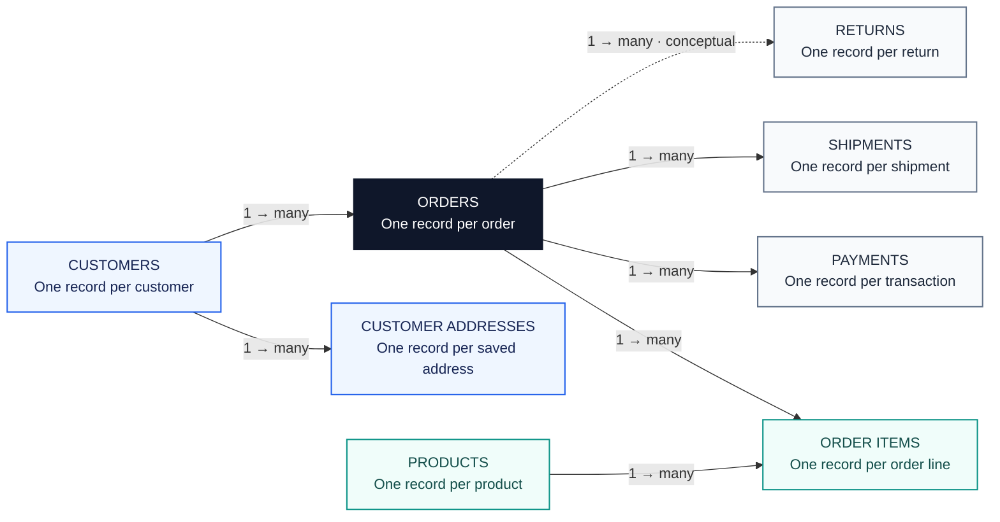

# RetailOps 360 — E-Commerce Operations & Revenue Analytics

**An e-commerce business analysis project covering customers, payments, deliveries, products, and returns.**

## Business problem

Retail teams lack a clear view of unpaid orders, delayed deliveries, inactive customers, and product returns. This makes it difficult to protect revenue, resolve service issues, and prioritize action.

RetailOps 360 brings these issues together to help teams identify what needs attention and make informed decisions.

## Business areas and decisions

| Business area | Decision supported |
|---|---|
| Customer & Sales | Prioritize customer activation, retention, and re-engagement. |
| Revenue & Payments | Resolve payment discrepancies and improve revenue reporting. |
| Fulfillment & Delivery | Prioritize delayed or unshipped orders and customer follow-up. |
| Products & Returns | Review product demand, assortment, and high return rates. |
| Data Quality & Integrity | Correct unmatched records and improve reporting accuracy. |

These analyses identify patterns and exceptions for review. A missing shipment record does not by itself prove an order was never shipped, and purchase inactivity does not by itself establish customer churn.

## Data model overview

Eight connected tables follow the customer journey from purchase to payment, delivery, and returns.



**Reading the model:** One customer can have many orders; each order can have multiple items, payments, and shipments. The dashed return relationship is conceptual; its exact linkage requires confirmation. See the [data model documentation](data_model/DATA_MODEL.md) for details.

**15 business questions**

1. Which 10 customers have the highest completed-order value, and how many completed orders did each place?
2. Which registered customers have never ordered, and how long have they been registered?
3. Which customers purchased in 2025 but have no completed purchases in 2026?
4. Which orders have multiple payment transactions, and what is the total payment amount for each?
5. Which orders are unpaid, underpaid, fully paid, or overpaid compared with captured payments?
6. How much can order value be overstated when multiple payment records cause orders to be counted more than once?
7. Which completed orders have no shipment record?
8. Which deliveries arrived after the expected date, and how many days late were they?
9. Which fully paid, completed orders have no confirmed delivery?
10. Which product categories have the highest merchandise value and units sold from completed orders?
11. Which products have never appeared in a customer order?
12. Which products have the highest return rates, and how do rates vary by category?
13. Which orders have missing customer IDs or reference customers absent from the customer records?
14. Which payments cannot be matched to an order, and what is their total value?
15. Which orders and payments fail reconciliation because of unmatched records or amount differences?

## Project scope and status

- **Source:** `retailops360.source`
- **Dataset:** Synthetic Canadian e-commerce data across 8 related tables; approximately 311,025 rows in the prepared dataset
- **Period represented:** January 2024–September 2026
- **Published work:** 15 business questions across 5 notebooks, with saved result previews and original executed HTML reports
- **Planned:** business performance dashboard and a consolidated findings summary

The notebook copies were reconstructed from executed HTML exports. Saved tabular previews contain up to 100 rows per query; preview row counts should not be treated as full result counts. Data generation and loading scripts are not currently included in this repository.

## Explore the analyses

GitHub renders the notebooks with business questions, analysis, and saved result previews.

| Questions | GitHub notebook | Original report |
|---|---|---|
| 01–03 | [Customer & Sales Performance](notebooks/01_Customer_Sales_Performance_Analysis.ipynb) | [HTML report](notebook_reports/01_Customer_Sales_Performance_Analysis.html) |
| 04–06 | [Revenue & Payment Reconciliation](notebooks/02_Revenue_Payment_Reconciliation_Analysis.ipynb) | [HTML report](notebook_reports/02_Revenue_Payment_Reconciliation_Analysis.html) |
| 07–09 | [Fulfillment & Delivery Performance](notebooks/03_Fulfillment_Delivery_Performance_Analysis.ipynb) | [HTML report](notebook_reports/03_Fulfillment_Delivery_Performance_Analysis.html) |
| 10–12 | [Product & Returns Performance](notebooks/04_Product_Returns_Performance_Analysis.ipynb) | [HTML report](notebook_reports/04_Product_Returns_Performance_Analysis.html) |
| 13–15 | [Data Quality & Order Integrity](notebooks/05_Data_Quality_Order_Integrity_Analysis.ipynb) | [HTML report](notebook_reports/05_Data_Quality_Order_Integrity_Analysis.html) |

GitHub's source view does not render the HTML reports. Open the notebook links to read queries and results directly on GitHub.

## Data model and measurement approach

The dataset contains `customers`, `customer_addresses`, `products`, `orders`, `order_items`, `payments`, `shipments`, and `returns`. See the [source data model](data_model/DATA_MODEL.md) for intended table grain and conceptual relationships.

Reliable analysis depends on keeping the measures distinct:

- **Completed-order value:** Order amounts for orders meeting the analysis's completed-status criteria.
- **Merchandise value:** Order-line value used to analyze products and categories.
- **Captured payments:** Eligible payment transactions used to reconcile money collected against order amounts.
- **Delivery confirmation:** Shipment records marked as delivered, evaluated separately from order and payment status.

Aggregate one-to-many records at the required grain before joining. Multiple payments or shipments can be valid operational events; investigate them in context. Validate status values, NULL handling, return linkage, and date filters before interpreting results.

## Repository structure

```text
RetailOps360/
├── README.md
├── index.html
├── data_model/
│   └── DATA_MODEL.md
├── notebooks/
│   ├── 01_Customer_Sales_Performance_Analysis.ipynb
│   ├── 02_Revenue_Payment_Reconciliation_Analysis.ipynb
│   ├── 03_Fulfillment_Delivery_Performance_Analysis.ipynb
│   ├── 04_Product_Returns_Performance_Analysis.ipynb
│   └── 05_Data_Quality_Order_Integrity_Analysis.ipynb
├── notebook_reports/
│   ├── index.html
│   └── [5 executed HTML reports]
└── dashboard/
    └── screenshots/  [placeholder for planned dashboard]
```

## Next steps

1. Consolidate validated findings, exception counts, and business recommendations from the five published analyses.
2. Document reproducible dataset setup and KPI definitions.
3. Build a business performance dashboard and add screenshots.

_All data is synthetic and does not represent transactions or customers of a real company. No business improvement or financial impact is claimed without supporting evidence._
