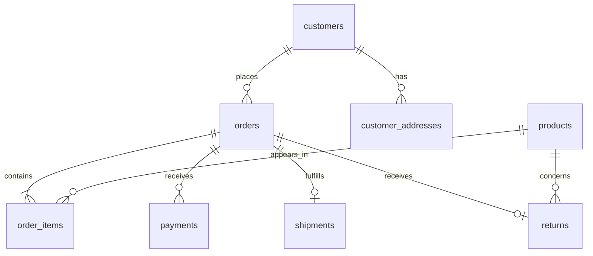

# RetailOps 360 | Source data model

**Dataset:** 311,025 synthetic records, eight CSV tables, January 2024–September 2026. All names and transactions are fictional. Prices are in CAD. Source data is deliberately denormalized only where business-friendly (order_amount is a header total); it is not a real company dataset.

## Entity relationship diagram

## Table grain, key and row counts

| Table | Records | Primary key | Foreign key(s) | Grain |
|---|---:|---|---|---|
| customers | 15,000 | customer_id | — | one registered customer |
| products | 2,500 | product_id | — | one catalog product |
| customer_addresses | 30,000 | address_id | customer_id → customers | one address type per customer |
| orders | 55,000 | order_id | customer_id → customers | one placed order |
| order_items | 105,571 | order_item_id | order_id → orders, product_id → products | one order line |
| payments | 55,685 | payment_id | order_id → orders | one captured payment transaction |
| shipments | 43,854 | shipment_id | order_id → orders | one shipment/delivery record |
| returns | 3,415 | return_id | order_id → orders, product_id → products | one return request |
| **Total** | **311,025** | | | |

## Relationships and grain cautions

- `customers` → `orders`: 1:M; the last 2,000 registered customers have no orders by design.
- `orders` → `order_items`: 1:M, between 1 and 4 lines per order.
- `products` → `order_items`: 1:M; last 200 products are never ordered.
- `orders` → `payments`: 1:M; some orders have no payments, and some have split payments. Sum payments **by order** before joining to order-level totals.
- `orders` → `shipments`: 1:0..1; some completed orders have no shipment record; `delivered_date` is populated only for delivered shipments.
- `orders` → `returns`: 1:0..1; `returns.product_id` identifies a product present on the order.
- `customers` → `customer_addresses`: 1:2, one Billing and one Shipping address per customer. Joining both types without role filters multiplies rows.

## Important fields

- `orders.order_amount`: order-header merchandise total, calculated as SUM(order_items.quantity * order_items.unit_price); no tax or shipping fee.
- `orders.order_status`: Completed / Pending / Cancelled.
- `payments.payment_amount`: captured amount; deliberately includes underpayment and overpayment cases.
- `shipments.delivered_date`: actual delivery date when `shipment_status='Delivered'`.
- `orders.expected_delivery_date`: target date, suitable for on-time delivery comparison.
- `returns.return_status`: Approved / Requested / Rejected; not every return request should reduce recognized sales.
- `customers.signup_date`, `orders.order_date`: useful for customer cohort and monthly revenue dashboard trends.

## Intentional scenarios for Phase 1 SQL

1. INNER/LEFT/RIGHT/FULL OUTER JOIN examples.
2. LEFT SEMI/ANTI JOIN examples: customers without orders, products without sales, orders without payments.
3. Multi-table joins: orders, customers, order_items, products.
4. One-to-many row multiplication: split payments and multiple order items.
5. GROUP BY and HAVING: multiple payments, top customers and categories.
6. NULL handling: missing delivery dates for undelivered shipments.
7. Status and date filtering: completed orders, late deliveries, order periods.
8. End-to-end reconciliation: payment amount vs order amount, shipping exceptions, returns.

**Data-quality scope:** All foreign keys in this initial source dataset are valid. Missing *related records* are intentional. Broken foreign keys and duplicate primary keys can be introduced later in a separate, clearly marked `quality_lab` dataset if needed for Phase 1 exercises. This keeps dashboard totals trustworthy.

## Dashboard-ready subject areas

- Revenue: completed order amount by month, channel, geography.
- Customers: registered vs purchasing, acquisition channel, average order value.
- Products: units and merchandise revenue by category, never-sold products.
- Payments: fully paid / underpaid / overpaid / unpaid order classification.
- Fulfillment: delivered share, late deliveries, missing shipments.
- Returns: requests by reason and approval status.

**Critical dashboard rule:** Calculate order revenue at order grain. Joining order headers directly to order lines or split payment transactions and summing `order_amount` will inflate revenue.
